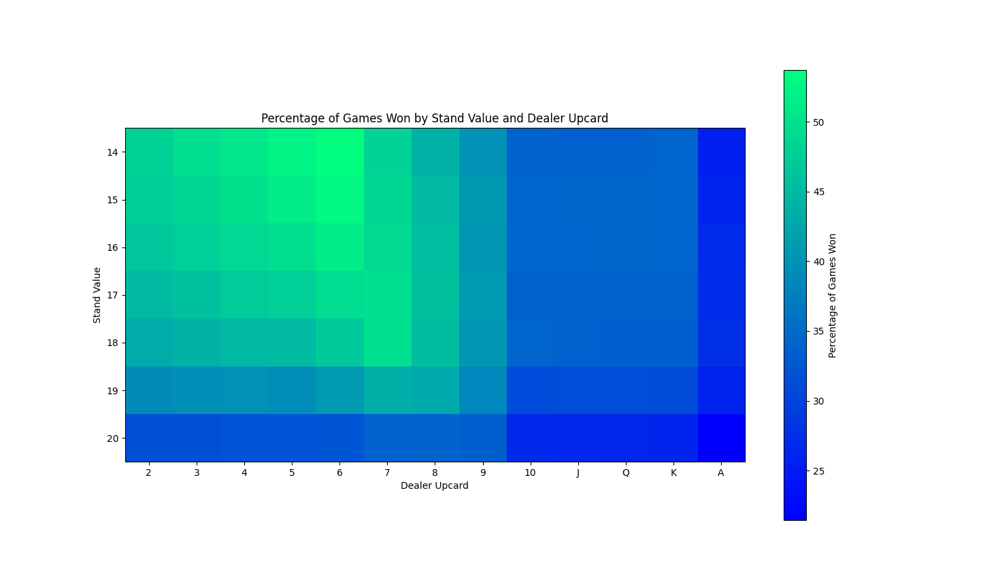
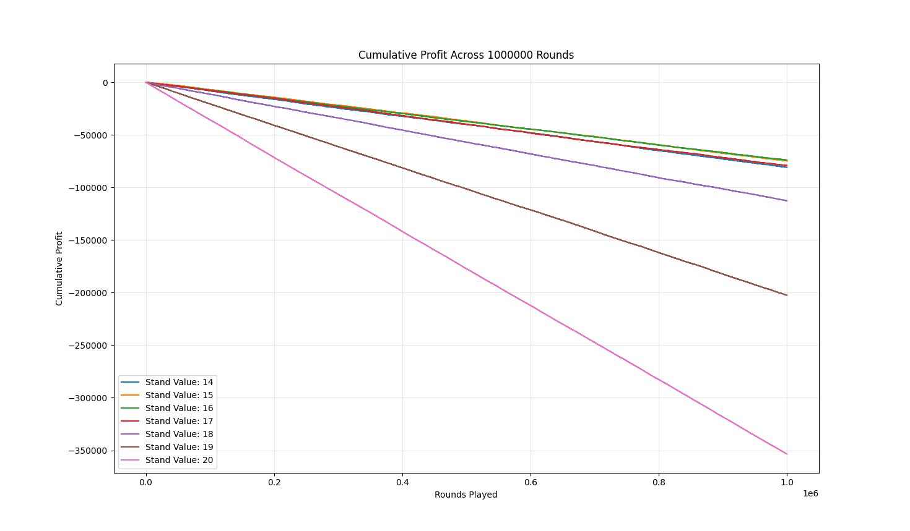

# BlackjackStrategySimulator

## Introduction
This project uses Monte Carlo simulation to investigate the relationship between different standing strategies and the outcome of Blackjack games. While simulating a large number of games, the simulator adjusts the value at which the player stands.

The results are organised and manipulated with Pandas, and plotted with Matplotlib.

The source file `blackjack.py` contains the game logic, whereas `simulation.py` runs the rounds, organises the results and draws the plots. 

## Assumptions
- The game assumes an infinitely large deck, so the probability of drawing any card is constant.
- A win increases profit by one, a loss decreases profit by one and a push leaves profit as is.
- The dealer stands on 17.

## Results

As the above heatmap shows, the most successful game outcomes occur when the dealer has an upcard of 6 and the player stands on 14. Furthermore, game outcomes sharply worsen when the dealer has an upcard worth 10, falling even more drastically when the upcard is an ace. Importantly, the dealer's upcard still affects the games' outcomes despite not being considered in the player's strategy (in this particular simulation).

As the plot above shows, standing on 18, 19 or 20 greatly increases the rate of losses over time. Interestingly, given the conditions and assumptions of the simulation, there is only a slight difference between the games' outcomes when standing on 14, 15, 16, or 17. The plot also reveals the linear nature in which losses are made over many games, regardless of strategy.

## Improvements
- Allow splitting, doubling down and insurance.
- Blackjack should pay 3:2 instead of 1:1.
- Make profit the primary figure of success, rather than the number of wins.
- For more complex strategies, both the player's cards and dealer's upcard should be taken into account.
- The deck size should be adjustable.
- Break up `simulation.py` into multiple smaller files, especially as the project expands.
- Further statistical analysis to better understand the relevance of the results.
